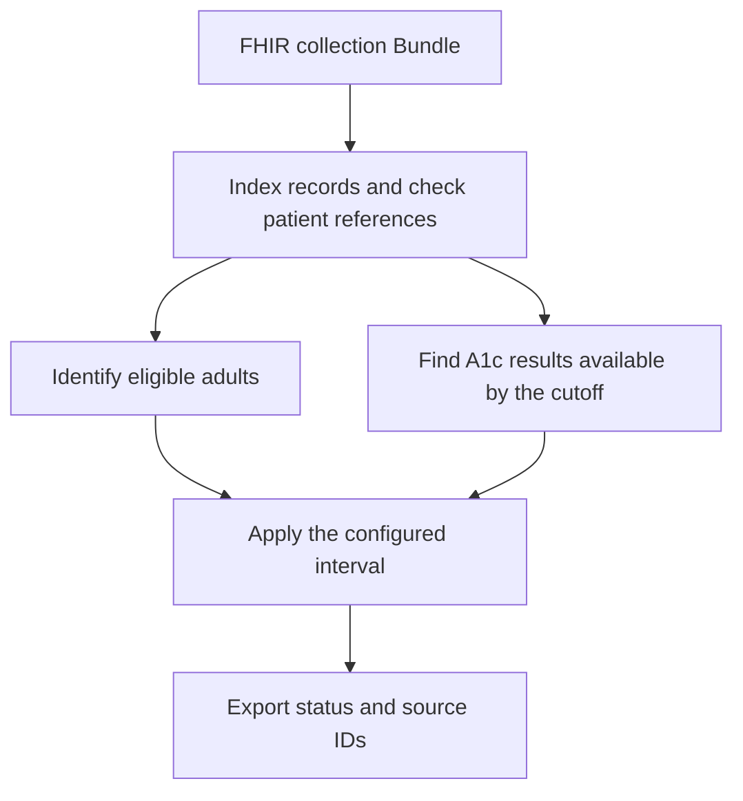

# FHIR Preventive Care Pipeline

**A Research prototype that turns synthetic FHIR R4 records into an auditable A1c monitoring worklist.**

A care-management team needs to distinguish patients with a recent result, patients due for monitoring, and patients whose records lack an eligible result. This project demonstrates how to make those distinctions with a configurable reporting policy, a fixed evaluation date, and source-record IDs that reviewers can use to trace each row.

The prototype applies one rule to adults with an active, confirmed, recorded type 2 diabetes diagnosis. It uses a synthetic dataset and an explicitly supplied interval. The sample interval illustrates the software behavior and has no clinical authority.

## What this project produces

| Question | Worklist evidence |
|---|---|
| Why is this patient in the cohort? | The ID of an eligible diabetes Condition |
| Which A1c result drove the status? | The qualifying Observation ID, measurement date, and value |
| When does the selected reporting interval end? | The measurement date plus the configured number of days |
| How should I interpret the row? | A status and machine-readable reason |
| Can I reproduce the decision? | The evaluation date, synthetic input Bundle, and exact command |

This project covers the interoperability and care-management workflow in the MedScope Analytics chronic-disease series. The **Cardiometabolic Risk Toolkit** estimates the probability of a future recorded diagnosis. This pipeline starts with already-recorded type 2 diabetes and applies a deterministic rule to existing monitoring records.

## Quick start

Use Python 3.11 or newer. The pipeline uses only the standard library. Run from the repository root.

```sh
python pipeline.py --input examples/synthetic-bundle.json --as-of 2026-01-01 --interval-days 180
python -m unittest discover -s tests -v
```

The output is written to `build/worklist.csv`. Open the file in a spreadsheet or compare it with the [expected worklist](examples/expected-worklist.csv). The [technical user guide](USER-GUIDE.md) documents the input contract and each output column.

## How it works



1. **Index synthetic FHIR records.** The loader indexes Patient, Condition, and Observation resources by resource type and ID. Identical duplicate records are accepted once. Conflicting records with the same identity and unresolved patient references stop the run.
2. **Construct the cohort.** Include adults with a matching type 2 diabetes Condition recorded by the evaluation date and marked active and confirmed in the input.
3. **Find an eligible lab result.** Select the latest HbA1c with the supported coding and units and an eligible status. Both the measurement and issue dates must be on or before the evaluation date. The rule chooses the latest measurement date, using issue date and resource ID to resolve ties.
4. **Apply the reporting policy.** Add the supplied number of days to the measurement date. Compare the resulting date with the evaluation date. Keep a separate status when there is no eligible result.
5. **Export a traceable row.** Write one row per eligible adult with status, reason, cutoff date, and available source evidence.

## Default example

The fixture includes six synthetic patients and yields five worklist rows. One patient is under 18 and falls outside the cohort.

| Sample patient | Status | Why |
|---|---|---|
| `demo-exact` | `due_today` | The evaluation date equals the measurement date plus 180 days |
| `demo-missing` | `no_eligible_result` | The fixture contains no A1c observation for this patient |
| `demo-overdue` | `overdue` | The selected result is 210 days old |
| `demo-pending` | `no_eligible_result` | The lab was measured before the cutoff and issued afterward |
| `demo-recent` | `up_to_date` | The selected result is 30 days old |

The same status can arise from different records. For example, an absent lab and a lab issued after the cutoff both produce `no_eligible_result`. The CSV status means the supplied records contained no result the pipeline could use at the evaluation date.

## Sample use cases

### 1. Produce a care-gap review list

A population health analyst runs the example and filters the CSV for `overdue` and `due_today`. The two rows represent different timing conditions. An additional filter for `no_eligible_result` creates a review queue for patients with insufficient evidence in the input records.

### 2. Trace a worklist decision to FHIR

A data engineer opens the `demo-overdue` row and looks up its `condition_id` and `latest_observation_id` in the [synthetic Bundle](examples/synthetic-bundle.json). Comparing the source dates and the selected 180-day interval reproduces the exported due date.

### 3. Recreate an earlier snapshot

A validation reviewer runs the fixture for January 1, 2026, and then January 3, 2026. The result for `demo-pending` changes after issuance. This shows how a retrospective report can avoid using results that were still unavailable at its cutoff.

### 4. Compare reporting policies

An analyst reruns the example with `--interval-days 240 --out build/worklist-240.csv`. The 210-day-old result moves from `overdue` to `up_to_date`. The eligible cohort is unchanged because the interval controls monitoring status and does not alter cohort membership.

### 5. Catch a broken link before exporting

A developer runs the reference-validation and duplicate tests. The checks demonstrate that adding a conflicting resource or breaking a patient reference fails the build before a worklist is written.

## Project files

| Path | Purpose |
|---|---|
| [Technical user guide](USER-GUIDE.md) | CLI options, input requirements, output dictionary, and reproducibility |
| [Pipeline](pipeline.py) | Resource indexing, cohort selection, date logic, and CSV export |
| [Synthetic Bundle](examples/synthetic-bundle.json) | Six patients with example Conditions and Observations |
| [Expected worklist](examples/expected-worklist.csv) | Reproducible output from the supplied fixture |
| [Tests](tests/test_pipeline.py) | Cohort boundaries, delayed issuance, resource duplicates, and patient references |
| [GitHub fields](docs/github-publishing.md) | Description, topics, first commit, and release notes |

## Scope

The prototype accepts a narrow FHIR resource subset and relative patient references. It operates on day-level timestamps and takes resource states from the supplied snapshot. Historical production reporting would require version-aware data, documented eligibility and outreach policies, terminology expansion, broader quality checks, and governance for authorized data.

**Intended use:** Research and education with synthetic records. The demo does not establish a clinical monitoring schedule or support patient care decisions.
